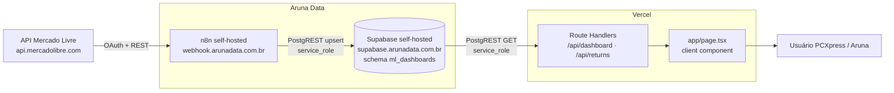

# 01 · Arquitetura e contexto

## Negócio

- **Cliente:** PCXpress, loja que vende computadores e peças no Mercado Livre.
  - Conta no banco: `accounts.account_name = "PC Express"` (é esse texto que o painel procura;
    variável `SUPABASE_ACCOUNT_NAME`). Na tela aparece como "PCXpress".
  - Apelido no Mercado Livre: `HEDAK`. Seller ID: `155871484`.
  - `account_id` no Supabase: `3cc8f0ba-4310-49b9-94ac-1073b35cfe71`.
- **Quem constrói e opera:** Aruna Data (domínio `arunadata.com.br`), que hospeda o n8n e o Supabase.
- **Para que serve o painel:** acompanhamento comercial (valor bruto, pedidos, ticket, conversão,
  ranking de anúncios), saúde da conta no ML (reputação, reclamações, atrasos, cancelamentos) e,
  desde outubro/2026, a operação de devoluções, que antes era feita na planilha
  `pcxpress-fila-devolucoes` (abas "Devoluções" e "Resumo"). A seção Devoluções reproduz as colunas
  e as regras dessa planilha.

## Componentes

| Camada | Tecnologia | Onde | Observações |
|---|---|---|---|
| Fonte | API do Mercado Livre | `api.mercadolibre.com` | OAuth 2.0 com refresh token; app com `client_id` `4779123939652829` (identificador público; o *secret* fica no n8n) |
| Ingestão | n8n self-hosted, nodes **Code** em JavaScript | `https://webhook.arunadata.com.br/` (base dos webhooks) | Roda em Docker Swarm gerenciado por Portainer (dá para ver nos fluxos `catalog-monitor`). Fuso: `America/Sao_Paulo`. Limite de 300 s por node Code (`N8N_RUNNERS_TASK_TIMEOUT`). Execuções guardadas por ~14 dias |
| Banco | Supabase self-hosted (Postgres + PostgREST) | `https://supabase.arunadata.com.br`, schema `ml_dashboards` | O schema precisa estar na lista de schemas expostos da Data API. Acesso sempre com `service_role` |
| Painel | Next.js 16 (App Router), React 19, TypeScript | Vercel, `https://pcxpress-ml-dashboard.vercel.app` (`metadataBase` em `app/layout.tsx`) | Sem `vercel.json`; detecção nativa do Next.js. Node 22.x |
| Código | GitHub | `pedromeneleu/pcxpress-ml-dashboard-nextjs` (conta pessoal) | PRs #1–#7 vieram de `pedromeneleu-coder` (conta de trabalho); #8–#10 de `pedromeneleu` |

Não existe SDK do Supabase no projeto: tanto o n8n quanto o painel falam com o PostgREST por
HTTP (`/rest/v1/<tabela>`), com os cabeçalhos `apikey`, `Authorization: Bearer`,
`Accept-Profile`/`Content-Profile: ml_dashboards`.

## Fluxo de dados ponta a ponta

1. **Token.** O node *MVP1 Seller* (nos fluxos "Sync Diario" e "Backfill - PCXpress") lê
   `oauth_tokens` e, se o `access_token` vence em menos de 5 min, renova com o `refresh_token` e
   grava o novo par. O MVP7 (devoluções) tem a mesma lógica. MVP2, MVP3 e MVP4 **não** renovam:
   dependem do MVP1 ter rodado antes no mesmo fluxo.
2. **Coleta.** Cada node busca um domínio na API (vendedor, anúncios, pedidos, visitas,
   reclamações/devoluções) e faz *upsert* nas tabelas "current" e "snapshot".
3. **Registro.** Cada node abre uma linha em `sync_runs` (`status = running`) e fecha com
   `success`/`error`.
4. **Agregação.** Views no Supabase (`dashboard_*`, `devolucoes_base_vendas_diaria`) entregam os
   dados já por dia/anúncio.
5. **Leitura.** O navegador chama `/api/dashboard` e `/api/returns`; essas rotas (servidor)
   consultam o Supabase com a `service_role`, calculam totais, comparações e percentuais e devolvem
   um JSON pronto para a tela.
6. **Sem Supabase** (variáveis ausentes, conta não encontrada, erro), o painel não quebra: devolve
   `FALLBACK_DASHBOARD_DATA` com `connected: false` e mostra "Dados de demonstração".

## Cadência (quando cada dado muda)

| Dado | Workflow / node | Frequência | Janela buscada |
|---|---|---|---|
| Token OAuth + perfil e reputação do vendedor | Backfill - PCXpress → MVP1 | a cada 2 h (minuto 0) | estado atual |
| Perfil/reputação + snapshot diário | Sync Diario → MVP1 | todo dia 19h (BRT) | estado atual |
| Anúncios (preço, estoque, status) | Sync Diario → MVP2 | todo dia 19h | todos os IDs devolvidos por `/users/{id}/items/search` (99 em 25/10) |
| Pedidos e itens de pedido | Sync Diario → MVP3 | todo dia 19h | últimos 30 dias pela data de criação, em blocos de 3 dias (905 pedidos em 25/10) |
| Visitas por anúncio por dia | Sync Diario → MVP4 | todo dia 19h | últimos 30 dias, para todos os anúncios de `items_current` (260 em 25/10) |
| Reclamações e devoluções | MVP7 Devolucoes v2 | de hora em hora (minuto 7) | reclamações criadas/atualizadas nos últimos 180 dias + todas as abertas |

Consequência prática: o painel comercial "fecha o dia" às ~19h; vendas depois disso entram no dia
seguinte. A data mais recente com dados (`availableDateRange.lastDate`) é a âncora dos atalhos
7d/30d/90d — **não** a data de hoje.

## Ambientes e variáveis

### Painel (Vercel e `.env.local`)

| Variável | Obrigatória | Uso |
|---|---|---|
| `SUPABASE_URL` | sim | URL do Supabase (aceita também `NEXT_PUBLIC_SUPABASE_URL` como alternativa) |
| `SUPABASE_SERVICE_ROLE_KEY` | sim | Chave `service_role`. **Secreta, só servidor** |
| `SUPABASE_SCHEMA` | não (padrão `ml_dashboards`) | Schema exposto |
| `SUPABASE_ACCOUNT_NAME` | não (padrão `PC Express`) | Valor de `accounts.account_name` a usar |
| `RETURNS_DEMO_MODE` | não | `false` desliga os dados fictícios de devoluções em qualquer ambiente; `true` liga localmente |
| `LOGISTICS_V2_ENABLED` | não | `true` ligaria a Logística V2 — sem efeito hoje, porque `logisticsEnabled = false` no código |
| `VERCEL_ENV` | automática | `production` / `preview`; decide o modo demonstração de devoluções |

Na Vercel as variáveis ficam em *Settings → Environment Variables* para Production, Preview e
Development. Modelo local: `.env.example` (sem valores) → copiar para `.env.local`.

### n8n

Não há variáveis de ambiente nem Credentials do n8n para estes fluxos: cada workflow tem um node
`CONFIG - …` (Code) que devolve um objeto com `ml_client_id`, `ml_client_secret`, `supabase_url`,
`supabase_service_role_key` e os parâmetros do fluxo. Detalhes por fluxo em [03-n8n.md](03-n8n.md).

## Segurança e dados pessoais

- **Segredos em texto puro** nos nodes `CONFIG` de todos os fluxos ML (ativos e inativos) e na
  URL do Google Chat (com `key` e `token`) dos fluxos `catalog-monitor`. Qualquer pessoa com acesso
  de leitura aos workflows vê as chaves. As cópias neste repositório estão limpas (`PREENCHA_…`).
- A `service_role` ignora RLS. As tabelas novas (devoluções) têm RLS ligado sem políticas, o que
  bloqueia as chaves `anon`/`authenticated` e deixa só a `service_role` — é o modelo pretendido.
- **Dados pessoais.** As tabelas de devoluções foram desenhadas para não guardar dados do
  comprador além do apelido. Já as tabelas comerciais guardam o JSON bruto da API (`raw`):
  `orders_current.raw` contém dados do comprador do pedido e `orders_current.buyer_id` é gravado;
  `sellers_current` guarda e-mail, nome e sobrenome do titular da conta vendedora. Levar em conta
  em qualquer pedido de LGPD ou ao abrir acesso ao banco para terceiros.
- O painel não tem login próprio: quem tem a URL vê os dados. Se isso não for intencional, é item
  de roadmap ([07-roadmap.md](07-roadmap.md)).

## Outros produtos que dividem a mesma infraestrutura

- **catalog-monitor** (imagem `ghcr.io/aruna-data/catalog-monitor`): outro produto da Aruna,
  também ligado ao Mercado Livre. Os fluxos `catalog-monitor sync`/`notify` só ligam e desligam
  serviços Docker via Portainer. O fluxo **`Onboarding ML - Callback`** recebe o redirecionamento
  OAuth (`/webhook/ml-onboarding`) e repassa `code`/`state` ao serviço interno
  `catalog-monitor-onboarding:3001`. **Não foi possível confirmar** se o token da PCXpress em
  `ml_dashboards.oauth_tokens` nasceu desse onboarding ou foi gravado manualmente; ver
  [08-runbook.md](08-runbook.md#token-do-mercado-livre-inválido).
- O mesmo n8n tem fluxos de outros clientes (Meta Ads, Kommo, WhatsApp, planilhas de prospecção),
  listados em [03-n8n.md](03-n8n.md#fluxos-de-outros-projetos-na-mesma-instância) apenas para
  ninguém confundir.
